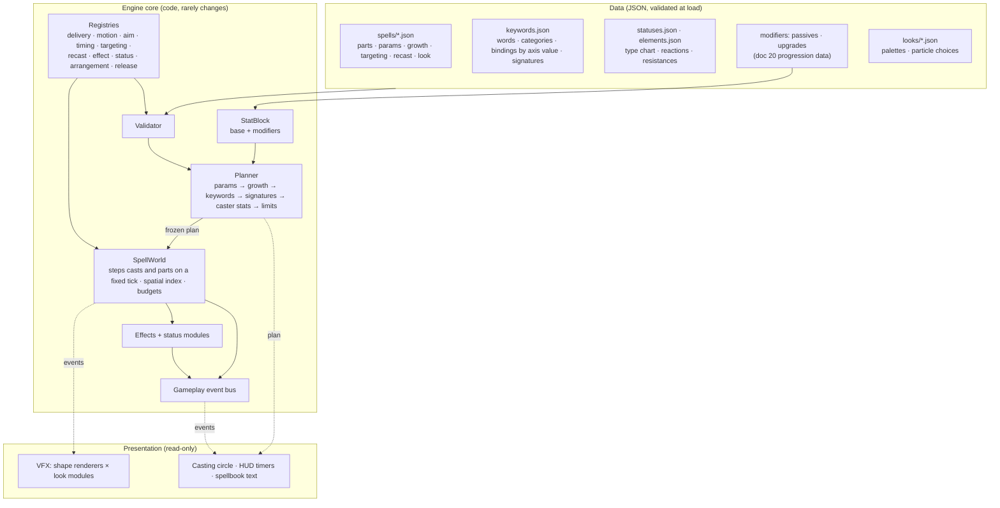

# Spell engine architecture: data-driven, expandable, scalable

**Status:** signed off with the §13 decisions · rev 3 · 13 October 2026 · companion: [doc 20, game systems](20-game-systems-architecture.md) · supersedes the "runner" parts of doc 18 §3 and §14 where they differ; doc 18 stays the design source for spells, keywords, statuses and art.

> **Sign-off:** ☑ approved 13 October 2026 with the §13 decisions (proposed defaults accepted)

## 1. Goals

1. **Data is the source of truth.** Every spell, number, rank curve, combination, keyword rule, status, element, reaction, targeting choice, recast rule and colour palette lives in data files. Balancing, adding a spell or adding a keyword is a data change.
2. **Expandable.** New behaviour (a delivery, a motion, a targeting rule, a status, a look) is one new module registered by id. Nothing else changes.
3. **Scalable.** The engine holds frame budget at horde scale: hundreds of enemies, hundreds of live spell parts, thousands of particles, on a mid-range laptop and in the web build.
4. **Well architected.** Clear layers, one direction of dependency, one way to do each thing, everything validated, everything tested by the same harness.
5. **Ready for the roadmap.** Summons, barriers, spell references, phases, owner/afflicted events, lob/fall motion, forces, global delivery (doc 18 Appendix B) all fit without restructuring.

**Casters.** The player, summons and allies cast through this system; enemies may later.

**Co-op-ready, not co-op.** No networking is built. The engine follows five rules (§6.1) that make adding host-authoritative co-op later a new layer, not a rewrite.

**Non-goals now:** building networking, a visual spell editor, modding support beyond "the data is readable and validated" (the format makes later modding cheap).

## 2. Principles

| # | Rule | Why |
|---|---|---|
| P1 | No spell id appears in engine code. Engine code knows mechanics; data knows spells. | Adding a spell never touches code |
| P2 | One registry per kind of mechanic; data names the mechanic by id. | Expansion is a new file |
| P3 | Every data file is validated against the schema its mechanics declare; unknown keys fail. | Typos are errors, not silent no-ops |
| P4 | The planner turns (spell data + caster stats + keywords) into a frozen plan; the runtime only executes plans. | Keywords, ranks and passives compose in one place; runtime stays simple |
| P5 | Presentation (VFX, audio, HUD) reads plans and events; it never changes gameplay. | Visual work cannot break play |
| P6 | Every hit goes through `Effects.apply`. | Elements, statuses, resistances, reactions and style credit work for everything |
| P7 | Hard budgets on every cast (depth, spawns, hits) and globally (live parts, particles). | No combination breaks a frame |
| P8 | Restructuring commits never change behaviour; behaviour changes never ride along with restructuring. | Regressions are attributable |
| P9 | Custom code is an escape hatch with a contract (doc 18 §10). Two custom spells sharing behaviour → that behaviour becomes a module. | The library of mechanics grows instead of special cases |
| P10 | Systems talk through the gameplay event bus (§5.4) and the caster interface; nothing reaches for "the player" or "the game" by group lookup. | Summons, allies and a second player are just more casters |

## 3. Architecture



**Dependency direction:** data → core → presentation. Core never imports presentation; mechanics never import each other except through the registry; the SpellManager is split (§3.1) and keeps no per-spell logic.

### 3.1 SpellManager split

`SpellManager.gd` today mixes typing, loadout, rank state, targeting, recast and per-spell builders. It becomes three small pieces:

| Piece | Owns | Does not own |
|---|---|---|
| `CastInput` | typed text → (spell id, words), assistance, preview, rejection messages | ranks, effects |
| `Loadout` | known/prepared/active spells, ranks, cooldown/recovery state per caster | input, effects |
| `CasterBridge` | builds the cast message (§6.1 rule 3) from caster + loadout + words and hands it to the planner | anything spell-specific |

A summon has a `Loadout` and a `CasterBridge` but no `CastInput`; its brain (doc 20 §3.3, the same behaviour library enemies use) picks the spell. A second player would have all three.

`CastInput` accepts **input modifiers** through the modifier system (scramble letters, hide a word, swap words), so rule-twisting bosses such as The Disruptor (doc 06) and future curses are data plus one module (doc 20 §3.7).

### 3.2 Directory layout (target)

```
data/spells/<school>.json        spell definitions (one file per school keeps diffs readable)
data/keywords.json               words, categories, bindings, signatures
data/statuses.json, elements.json, reactions.json, resistances.json
data/modifiers.json              stat modifier definitions (passives, elite and ley bonuses)
data/looks/<look>.json           palettes and particle choices per look
scripts/engine/core/             Planner, SpellWorld, Cast, Part (host), Registry, Validator, Budget
scripts/engine/mechanics/        one file per mechanic: deliveries/, motions/, aim/, timing/,
                                 targeting/, recast/, arrangement/, release/
scripts/engine/effects/          Effects, TypeChart, effects/ (one per effect type), statuses/ (one per behaviour pattern)
scripts/engine/stats/            StatBlock, Modifier
scripts/core/                    EventBus, Validator (shared with doc 20 systems), Rng
scripts/vfx/shapes/              one renderer per shape (projectile, burst, nova, field, beam, …)
scripts/vfx/looks/               one module per look (fire, ice, …)
tests/engine/                    validator, plan-equivalence, contract matrix, mechanics, budgets
```

## 4. Data model

### 4.1 A spell

A spell is the doc 18 §4 format plus three things that today live in code: **params** (every tunable number, named), **growth** (how params change with rank, combination ingredients and passives) and **rules** (targeting, recast, signatures). Parts reference params by name, so a number is written once.

```json
{
  "id": "ember_spear", "name": "Ember Spear", "incantation": "ember spear",
  "element": "fire", "school": "fire", "tags": ["projectile", "piercing"],
  "acquire": "learnable",
  "params": {
    "damage":        {"base": 96, "growth": {"per_rank": 39.4286}},
    "radius":        {"base": 24, "growth": {"per_rank": 5.1429, "max": 60}, "stat": "size"},
    "speed":         {"base": 1050, "stat": "velocity"},
    "trail_share":   {"base": 0.12},
    "trail_life":    {"base": 1.5, "stat": "duration"}
  },
  "damage_mix": {"raw": 0.75, "fire": 0.25},
  "targeting": {"rule": "line_through_most", "fallback": "nearest"},
  "recast": {"max_active": 3, "at_cap": "replace_oldest"},
  "root": "spear",
  "parts": {
    "spear": {
      "delivery": "projectile", "origin": "caster",
      "geometry": {"type": "body", "radius": "$radius", "pad": "hurtbox"},
      "motion": [{"type": "straight", "speed": "$speed", "range": "$speed"}],
      "payload": [{"type": "damage", "amount": "$damage"}],
      "limits": {"pierce": "unlimited", "hit_scope": "cast"},
      "events": {"on_travel": {"part": "strip"}}
    },
    "strip": {
      "delivery": "field", "origin": "parent",
      "geometry": {"type": "trail", "width_from_parent": true},
      "timing": {"type": "periodic", "interval": 0.5, "duration": "$trail_life"},
      "payload": [{"type": "damage", "share_of_hit": "$trail_share", "status": "burn"}]
    }
  },
  "bindings": {"size": ["$radius"], "power": ["$damage"], "duration": ["$trail_life"]},
  "look": {"family": "spear", "trail": "smoulder"},
  "audio": {"cast": "spear_cast", "hit": "fire_hit_heavy"},
  "copy": {"summary": "spell.ember_spear.summary", "rank_lines": "spell.ember_spear.ranks"}
}
```

| Field | Meaning | Validated against |
|---|---|---|
| `params` | Every tunable number. `stat` links it to a caster stat (size, duration, velocity, power) so passives apply without code | param schema |
| `growth` | Rank curve (`per_rank`, `per_rank_pct`, `max`, `table`); combinations declare `from_ingredient` | growth schema |
| `targeting` | Id of a targeting rule + its settings | the rule's declared schema |
| `recast` | `max_active`, `at_cap` (`replace_oldest`, `extend`, `refuse`, `extend_covering`), banking limits | recast rule schema |
| `parts.*` | Doc 18 axes; every value is an id in a registry; every number may be `"$param"` | each mechanic's declared schema |
| `bindings` | Which params the keyword categories touch (doc 18 §4.6); defaults come from the delivery | binding schema |
| `look` | Presentation hints only (family, trail style); never read by gameplay | look schema |
| `audio`, `copy` | Sound ids and text keys. Replaces the per-spell lists in `AudioManager`, `UpgradeCopy` and `BuildSummary` | id exists in the sound bank / string table |

**Combinations** are spells with `"ingredients": [...]` and params that declare `{"from_ingredient": "lightning.damage", "scale": 1.0}`; the combination-scaling rules in `CombinationScaling.gd` become data.

### 4.2 Keywords

`keywords.json` keeps today's words and categories and gains the doc 18 §8.4 table as data:

```json
"bindings": {
  "count":   {"projectile": {"arrangement": "fan"}, "volume": {"release": "staggered"}, "self": "reject"},
  "homing":  {"projectile": {"motion": "guided"}, "field": {"drift": "nearest_group"}, "self": "reject"},
  "lasting": {"field": {"scale": "duration"}, "projectile": "reject_unless_lingers"}
},
"signatures": {
  "meteor_shower × mega": {"arrangement": {"type": "single"}, "scale": {"impact_radius": "count"}}
}
```

The planner applies, in doc 18's resolution order: mechanic defaults → spell → keyword bindings per axis value → signatures → caster stats → limits. A word with no binding and no rejection for a part's axis value is a **validator error**, so the spell × keyword contract (every word changes something or is rejected) is enforced at load, not discovered in play.

### 4.3 Statuses, elements, reactions, looks

Numbers are already data (`statuses.json`, `spell_damage.json`, `resistances.json`, type chart). Behaviour is not: see §5.2. Remaining code-held rules move into data: reaction table (doc 18 §6.4), element → status map, per-look palettes and particle choices (today constants in `VfxPresenter.gd`). Damage types and resistances are defined once for the whole game in doc 20 §2.

## 5. Mechanics and registries

Each mechanic is one script implementing a small interface and declaring the settings it accepts. Registries map ids → scripts and are listed in one file per kind (explicit, no reflection).

| Kind | Interface (core methods) | Declares | Today → target |
|---|---|---|---|
| Delivery | `start(part)`, `step(part, dt)`, `finish(part)` | settings schema, which keyword categories it binds by default, events it emits | `match` in `SpellPart.gd` → `mechanics/deliveries/*.gd` (projectile, volume, field, aura, trap, beam, self, collectible, then summon, barrier, global) |
| Motion | `step(part, phase, dt) -> moved` | schema | `match` in `SpellPart._step_projectile` → `mechanics/motions/*.gd` (straight, guided, spiral, orbit, hold, return, chase, then lob, fall, wander, follow) |
| Aim | `facing(part, dt)` | schema | beam-only logic → `mechanics/aim/*.gd` (fixed, track, sweep, caster_facing) |
| Timing | `due(part, dt) -> bool` | schema | periodic/per-target/shared-clock branches → modules |
| Targeting | `pick(caster, context) -> target/point` | schema | `SpellManager.ported_target` `match` → `mechanics/targeting/*.gd` (nearest, line_through_most, area_cluster, visible_host, spirit_free, densest, weighted_points) |
| Recast | `on_recast(world, cast_plan) -> new/extended/refused` | schema | `SpellManager._apply_recast` → `mechanics/recast/*.gd` |
| Arrangement / Release | `place(n, ctx)` / `schedule(n, ctx)` | schema | inline in `GenericCast` → modules |
| Effect | `apply(target, effect, source)` | schema | `Effects.gd` `match` → `effects/*.gd` |
| Status | `on_apply/on_tick/on_expire` | stacking rule | mostly `StatusComponent` → `effects/statuses/*.gd` |

### 5.1 Effects as modules

`Effects.apply(target, effect, source)` stays the single entry point (P6). Inside, each effect `type` (damage, heal, status, knockback, pull, shield_charge, summon, cleanse, mana…) is one module declaring its schema. Damage resolution order is fixed and shared with enemies hitting the player (doc 20 §2): split by `damage_mix` → type chart → resistance → status `on_hit` reactions → modifiers (vulnerable, barrier) → apply → events.

### 5.2 Statuses as behaviour patterns

Today `statuses.json` holds numbers but `StatusComponent` holds behaviour in a `match id` (burn, bleed, poison, chilled, shocked) and hand-written reactions in `on_hit`. DoTs and other effects are therefore not built the same way. Target: a status is **data choosing a behaviour pattern**; patterns are modules.

| Pattern | Behaviour | Today's statuses using it | Future ones |
|---|---|---|---|
| `instances` | independent stacks, each with its own clock, cap N, replace weakest (doc 07 status rules) | burn | plague rot |
| `meter` | builds a meter; at threshold bursts and resets | bleed → hemorrhage | stagger |
| `ramp` | one instance whose rate grows while refreshed | poison | |
| `threshold` | stacks to N, then converts to a timed lock with immunity window | chilled → frozen | rooted, stunned |
| `chain` | on tick or trigger jumps to nearby targets with falloff | shocked | conductive |
| `lock` | timed hard CC; boss conversion and immunity from doc 07 | frozen | stun, root |
| `modifier` | pushes a stat modifier (§5.3) while present | slow | vulnerable, haste, weaken |

```json
"burn":    {"pattern": "instances", "max_stacks": 3, "tick": 0.5, "dps_from_hit": 0.2, "duration": 3, "element": "fire", "damage_type": "fire"},
"chilled": {"pattern": "threshold", "stacks_to": 5, "becomes": "frozen", "each": {"modifier": "move_mult", "value": -0.1}}
```

**Reactions** become a table in `reactions.json`: `{"when": {"has": "chilled", "hit_type": "fire"}, "do": [{"remove": "chilled"}, {"effect": "damage", "type": "water", "share_of_hit": 0.5}], "event": "reaction.steam"}`. Fusion vs reaction by `cast_id` (doc 18 §6.4) is a rule in the table runner, not per-pair code. The status component on any actor (enemy, player, summon) is the same component.

### 5.3 Caster stats and modifiers

Player stats are mutable fields today (`Player.gd` fields read via `cast_stat`; `apply_upgrade` matches on effect type). Target: every actor that casts or takes damage has a **StatBlock**: base values from data plus a list of modifiers `{stat, op: add|mul|override, value, source, duration?, stacks?}`. Final value = (base + Σadd) × Π(1+mul), override wins, then clamps from data.

Everything that changes a number is a modifier with a source: passives and level-up cards, ley attunement (+20% power today as a constant), elite modifiers, slow/haste statuses, keywords at plan time. Removing a source removes its modifiers. The planner reads stats from the caster's StatBlock only (rule 3 of §6.1 freezes them into the cast message). Same component on enemies, so "vulnerable" or "elite armored" is one modifier, not a field.

### 5.4 Gameplay event bus

One typed bus (`EventBus`) for gameplay facts: `cast_released`, `part_spawned`, `hit`, `damage_dealt`, `status_applied`, `status_expired`, `reaction`, `heal`, `block`, `kill`, `hit_taken`, `pickup`, `level_up`, `upgrade_taken`, `objective_changed`, `run_state_changed`. Each event is a small dictionary with ids (caster id, target id, cast id), never node references held past the frame.

Consumers subscribe: style score, damage-by-spell stats, audio, HUD, VFX, achievements, the debug overlay and, later, the network layer. Producers do not know consumers. This removes today's reach-ins (`Enemy.take_damage` calling `get_first_node_in_group("game").style_session.record_damage`) and the global `DamageSource.current` (the cast id travels in the event and the part instead).

### 5.5 Phases and events

**Phases** (doc 18 gap A) are the general form of today's motion phases and recast segments: a part has an ordered list of phases, each may set motion, aim, timing, payload scale and active events, and ends on an `until` condition. Cross Blade, Earth Shield charges, seeds and the meteor ring all use it; today's `segments` become a recast rule that appends phases.

**Events** have four sources (doc 18 §4.3): part, owner (caster hit / block / travel / cast), afflicted (status carrier ticks / dies), reaction. This replaces today's special cases: Fire Walk's emitter (`on_caster_travel`), the infection-only delivery (`on_afflicted_tick` / `on_afflicted_death`), Earth Shield's hand wiring (`on_block`).

**Caster** is an interface (stable `actor_id`, position, facing, team, StatBlock, status component, hurtbox, loadout), implemented by the player, summons and (later) enemies. Recipients (`enemies`, `self`, `allies`, `pickups`, `corpses`) are resolved by team, so a summon's Ember Spear hits the player's enemies with no code change.

## 6. Runtime and scale

| Concern | Design |
|---|---|
| Stepping | One `SpellWorld` steps every cast and part on the fixed physics tick, in a stable order. Parts are pooled lightweight objects, not one scene node each; presentation draws them from the VFX layer (it already does). |
| Enemy queries | One spatial grid rebuilt (or incrementally updated) per tick; every "who is inside / nearest / along this line" query goes through it. No per-part scans of the `enemies` group. |
| Budgets | Per cast: depth 3, spawns 48 (doc 18 §4.5), hits per target per `hit_scope`. Global: live parts, live casts, particles, status overlays; over budget = oldest/lowest-priority work dropped deterministically and logged in debug. |
| Determinism | Seeded RNG per cast; fixed step; stable iteration order. Same inputs → same plan and same hits (tests and replays). |
| Hot paths | Payload application batched per tick; status ticks run in the status component on its own clock; no allocation in per-frame stepping (pools). |
| Measurement | A benchmark scene (the showcase in stress mode) records frame time, parts, enemies and particles; a budget test fails if the reference scenario exceeds its frame budget. |

### 6.1 Co-op-ready rules

Research summary: horde games that ship co-op either run **deterministic lockstep** (every peer simulates everything from inputs; Valor Hunters on Photon Quantum with fixed-point maths) or **host-authoritative state sync** (host simulates, clients receive compact state). Lockstep needs bit-exact maths across machines; GDScript floats and Godot physics give no such guarantee between Mac and web, so lockstep is out. Godot's own model is host-authoritative (multiplayer authority per node, server by default; `MultiplayerSynchronizer` replicates properties from the authority). Per-node synchronizers do not scale to hundreds of enemies, so a future layer would send batched enemy snapshots plus cast messages. Nothing below builds that layer; the rules only stop us from making it impossible.

| # | Rule | Enforced by |
|---|---|---|
| 1 | Casting, damage, pickups and stats go through the **caster interface** with an `actor_id`, never "the player" | code review + rule 2 check |
| 2 | **No global player lookups** in engine or game-systems code (`get_first_node_in_group("player")`, `/root/Game/Player`). Systems receive actors or query a registry of actors by team | CI grep, allow-list for UI only |
| 3 | A cast is fully described by a **small message**: `{caster_id, spell_id, words, stat_snapshot, seed, tick, aim}`. Planner + world produce the identical plan from it | plan-equivalence test rebuilds plans from messages |
| 4 | **Gameplay and presentation are separate.** Presentation reads events and state; gameplay never reads presentation (no damage from particle positions, no logic in `_draw`) | P5, review |
| 5 | **Per-cast seeds and a fixed step.** All gameplay randomness comes from seeded `Rng` streams (cast, spawn director, loot), never `randf()` | CI grep for bare `randf`/`randi` in gameplay paths |

With these, co-op later means: host runs everything as today; clients send inputs/cast messages; host sends cast messages (clients draw the spell locally from the same seed), batched actor snapshots and gameplay events. Estimated as a feature, not a rewrite. What still would need work then: lag compensation for hit feel, client prediction of the local wizard's movement, a lobby/session layer and second-player UI.

**Reference scenario for budgets (proposed, adjust after first measurement):** 300 enemies, 6 spells plus combinations active, MEGA and TRIPLE in use, 60 fps on the MacBook and ≥ 45 fps in the web build.

## 7. Presentation

Mirrors the engine: **shape renderers** (one per delivery/geometry shape: projectile, burst, nova, wave, slash, field, trap, beam, infection, eruption…) ask a **look module** (fire, ice, lightning, water, life, arcane, plague, earth) for its particles, bodies, rims and statuses. Palettes come from `data/looks/*.json`. Element reactions stay in one reaction renderer keyed by element pair (data-listed). A shape a look does not support keeps placeholder art and is reported by the coverage test. Props (seeds, shield charges) disappear as a concept once collectibles and charges are engine parts.

## 8. Validation and tests

| Test | Proves | Runs |
|---|---|---|
| Schema validator | Every data file (spells, keywords, statuses, reactions, modifiers, and doc 20's enemies, encounters, progression) well-formed; every id resolves; every keyword × part binding is defined or rejected | Load (debug builds) and CI |
| Co-op rules | Rule 2 and 5 greps; plans rebuilt from cast messages match | CI |
| Status patterns | Each pattern against a fake actor; reaction table cases from doc 18 §6.4 | CI |
| Plan equivalence (golden) | Moving a spell to data changed no number: plans for every spell at ranks 1–8, MEGA on/off, each combination | CI during migration, then as regression |
| Contract matrix | Every spell × every word: measurable change or rejection with a reason (doc 18 §14 phase 4) | CI |
| Mechanic unit tests | Each module in isolation against a fake world | CI |
| Coverage | Every spell × look drawn without placeholder | CI |
| Budget | Reference scenario within frame budget | CI (headless timing) + manual web check |
| Behaviour suite | Existing regression tests | CI |
| Balance | Bot runs per doc 18 §15 | On request |

## 9. Tooling

- **Balance from data:** params and growth are the only place numbers live; a generated table (spell × rank × key numbers) is written to `builds/balance/` for review and spreadsheet use.
- **Live iteration:** the arena and the in-game showcase reload spell data on a key press.
- **Docs from data:** the spellbook text and doc tables for spell numbers are generated from the same data, so they cannot drift.

## 10. Migration plan

The game stays playable at every step; each step lands with the full suite at baseline.

| # | Step | Exit criteria | Size |
|---|---|---|---|
| 0 | Sign off this doc | §13 decisions answered | — |
| 1 | Validator + schemas for current data (all data files, shared with doc 20); `EventBus`; seeded `Rng`; CI greps for rules 2 and 5 (allow-list of current violations that must shrink) | All current data passes; a deliberately broken file fails; allow-lists recorded | M |
| 1b | StatBlock + modifiers on player and enemies; move `apply_upgrade`, ley bonus and elite multipliers onto it | Suite green; same numbers in a stat snapshot test | M |
| 2 | Registries; split `SpellPart` deliveries/motions and `GenericCast` arrangement/release into modules; SpellWorld + spatial grid; pooled parts | No behaviour change (suite + golden plans); test-only delivery and motion added as one file each; benchmark recorded before/after | L |
| 3 | Spells as data: params, growth, targeting and recast rules; move all 22 shipping spells, Magic Missile, Regeneration and the combinations; delete `LegacyBridge` and SpellManager per-spell logic | Plan equivalence for every spell/rank/MEGA; no spell id in engine code (grep check in CI) | L |
| 3b | Statuses and effects as modules: behaviour patterns, reactions table, effect-type modules; same component on player | Suite green; status-pattern tests; `match id` gone from status code | M |
| 4 | Phases + owner/afflicted events + collectible delivery; port Fire Walk, Infestation, Soul Bloom, Earth Shield, Cross Blade, seeds onto them; one heal stream | Suite green; special-case code deleted | M–L |
| 5 | Keywords as data: bindings (8.4), signatures (8.5), stacking (8.2) | Contract matrix green | M |
| 6 | Presentation split: shape renderers × look modules, palettes in data | Coverage green; new test look = one file | M |
| 7 | Roadmap mechanics as content needs them: summon, barrier, spell references, lob/fall/wander, forces, global, links, per-copy variation; enemy-side capabilities (doc 18 §7) | Each with its first spell and a behaviour test | per item |

Order rationale: validator, bus, RNG and stats first because every later step and doc 20 build on them;; engine modules before spells-as-data so the data format targets the final module ids; golden plans guard both; keywords after deliveries are modules because bindings key on them; presentation is independent and can move earlier if art is waiting.

## 11. How to add things (acceptance)

| Add | Touch | Never touch |
|---|---|---|
| A spell from existing mechanics | `data/spells/<school>.json` | code |
| A balance change, including rank curve | the spell's `params` / `growth` | code |
| A keyword word in an existing category | `data/keywords.json` | code |
| A keyword with new behaviour | data + one mechanic module if no existing mechanic expresses it | planner, other mechanics |
| A delivery / motion / aim / targeting / recast rule | one module + one registry line | other modules, data of other spells |
| A status | `statuses.json` + one status module if it has new behaviour | effects pipeline |
| An element look | `data/looks/<look>.json` + one look module | shape renderers |
| A summon or ally that casts | spell data using `summon` delivery and `cast` references | caster-specific code |
| A status with a new behaviour | one pattern module + `statuses.json` entry | other statuses, Effects |
| A passive or upgrade | modifier entries in data (doc 20 §5) | Player.gd |
| A new listener (achievement, stat, sound) | subscribe to the event bus | the system producing the event |

## 12. Risks

| Risk | Mitigation |
|---|---|
| Numbers drift while moving to data | Golden plan equivalence before any old path is deleted |
| Engine restructure regressions (where this session's port bugs came from) | One module per commit, suite + golden plans each time, no behaviour changes mixed in |
| Pooled parts break code that expects nodes | Part host keeps the same API; tests that reach into nodes are updated in the same step |
| Schema too rigid for experiments | `custom` escape hatch with the doc 18 §10 contract; promotion rule P9 |
| Performance target unknown | Measure first in step 2; budgets become tests |
| Co-op rules ignored over time | CI greps with shrinking allow-lists; cast-message plan test |
| Event bus becomes a hidden global with ordering bugs | Typed event list in one file; synchronous dispatch in emit order; gameplay may not depend on a listener's side effects |

## 13. Decisions for sign-off

1. **Data layout:** *Decided.* One file per school under `data/spells/`.
2. **Reference scenario and frame budgets:** *Decided.* 300 enemies, 60 fps MacBook, ≥ 45 fps web as the starting target; revisit after the first measurement.
3. **Pooled parts:** *Decided.* In step 2, while the modules are being cut.
4. **Enemies casting:** *Decided.* Enemy shaped attacks use the engine from doc 20 G3; full enemy spellcasting follows content.
5. **Co-op-ready, not co-op:** *Decided.* Adopt the five rules in §6.1 and the host-authoritative direction; build no networking.
6. **Status patterns:** *Decided.* §5.2 as the status model (seven patterns; new ones added as modules).
7. **StatBlock with modifiers:** *Decided.* For player, summons and enemies, replacing mutable stat fields.

## 14. Out of scope

Networking code, lobbies, prediction; a spell editor UI; final art pipeline (doc 18 §13); new spells and keywords beyond what tests need (they follow in step 7 and content batches); balance changes (bot runs after step 3).
