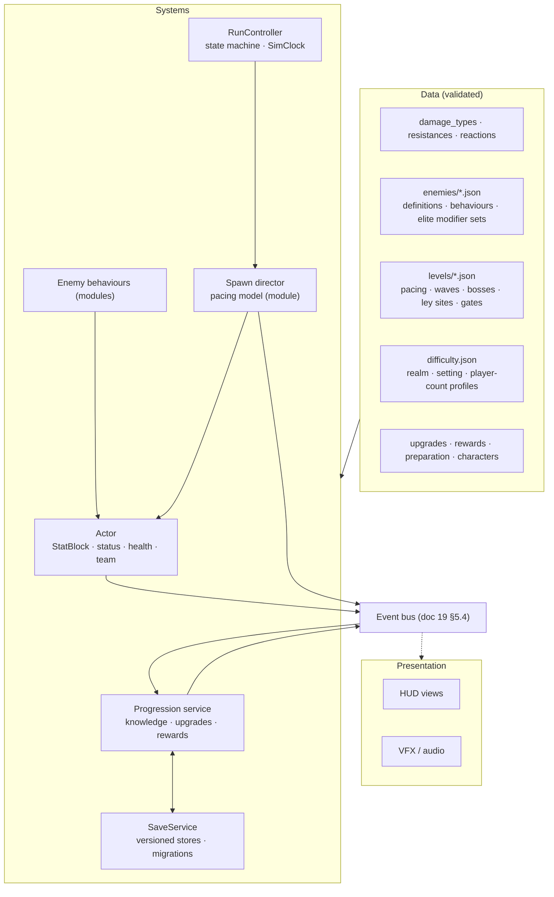

# Game systems architecture: damage, enemies, difficulty, progression, saves, run flow

**Status:** signed off with the §13 decisions · rev 3 · 13 October 2026 · companion to [doc 19, spell engine](19-engine-architecture.md). Design numbers stay in docs 05, 06, 07 and 18; this doc decides **where they live and which code owns them**.

> **Sign-off:** ☑ approved 13 October 2026 with the §13 decisions (proposed defaults accepted)

## 1. Goals and current state

Same goals as doc 19 (data is the source of truth, one module per behaviour, validated, scalable, co-op-ready not co-op), applied to everything around the spells.

Historical architecture baseline (inspected 13 October 2026, HEAD `fe037047`; not a current missing-work checklist):

| Area | Today | Problem |
|---|---|---|
| Damage to enemies | Typed: `damage_mix` → type chart → `resistances.json` profile → status reactions (`Enemy.resolve_untyped_hit`, `Effects.resolve_damage`) | Good base. Shieldbearer front guard is a variant check in `EncounterEnemy.take_damage`; knockback resistance is a hand-written formula on `enemy_type`, size and elite type |
| Damage to the player | Single untyped number into `Player.take_damage` | Player cannot resist, be vulnerable or react; enemy damage type is undefined |
| Enemy data | **Two sets.** Live: `encounters.json` variants (12, families grunt/runner/brute/shooter). Legacy: `enemies.json` (zones, classes with `physical`/`magic` resistances, 20 behaviour names, special abilities) read only by `DataManager`, `Enemy.gd` and `EnemyManager` | Legacy keys clash with the damage types; two truths |
| Enemy code | `EncounterEnemy` (223 lines, `match variant`) extends `Enemy` (952 lines, `match enemy_type`, `match elite_type`). `EnemyManager` (285 lines) has no caller in `scripts/` outside legacy code (scenes and tests checked in G1). Elite types (armored, regenerator, splitter, frost, explosive) are never spawned by `MonsterManager` | Behaviour by variant name; dead code; elites unreachable in play |
| Spawning and difficulty | `MonsterManager` (362 lines) reads `encounters.json` scaling (interval phases, difficulty points, batch points, cap 160); `EncounterDirector` for waves; `DayCycle` (328 lines) drives day/night | Two boss tables: `encounters.json` bosses (1200/1800 HP) for timeline mode, `DayCycle.BOSSES` const (1000/5000/9000/18000) for day mode |
| Ley lines | `LeyLines.gd`: ~25 tuning constants (3 sites, 4 words, wave sizes, +20% attuned power, guardian 450 HP + 150/min) | Balance in code; the expedition target says four sites |
| Upgrades | `LevelUpScreen` (740 lines) builds cards, "Recovery" defined inline; `Player.apply_upgrade` matches effect type; `SUPPORTED_PASSIVES` const | Adding an upgrade touches UI and player code |
| Preparation | `Preparation.gd`: 6 slots, activation levels `[1,2,4,7,11,16]`, defaults as consts; `user://preparation.cfg` | Numbers in code; own save format |
| Saves | Five stores: `CharacterManager` slot files, `Preparation` ConfigFile, `StyleScoreStore`, `UserSettings`, `EffectPreferences` | No shared versioning, migration or atomic write |
| Run flow | `Game.gd` 1438 lines, 101 functions: HUD, slots, camera, run state, extraction, level-up queue, particles, time dilation, console, pools | One file owns everything; run state is implicit |
| Cross-system calls | `Enemy.take_damage` → `get_first_node_in_group("game").style_session`; `DamageSource.current` static; `LeyLines`/`DayCycle` → `game.get_node("MonsterManager")` | Hidden coupling; blocks co-op rule 2 |

### 1.1 Alignment with the expedition design package

Checked against docs 05, 06, 07, 10, 15 and 18. The structure carries every rule in them as data or a module. Where the docs and the code disagree today, this doc does not pick silently:

| Point | Design docs | Code today | This doc |
|---|---|---|---|
| Enemy resistance profile | Per damage type, per status, control (hard-CC reduction, diminishing returns), weight | damage per type only; weight is a formula | full profile (§2.1) |
| Resistance ranges | Ordinary ±25%, elite ±50%, boss ≤ 50% in one type; no compulsory elemental hard counters (docs 15/16) | not enforced | validator enforces ranges by tier |
| Enemy capabilities | Capabilities listed in §3.8 | partly done | every row mapped to a module and a step (§3.8) |
| Guardians | the expedition target: telegraphed patterns A/B/C, recovery, 50% phase, capped adds, no new immunity, realm-fixed stats, one reward | timed big variants with health override | boss definition schema (§3.7) |
| Elites | the earlier encounter proposal: generic modifier + silhouette, not tint; the expedition target: patrol elites at 4/8/12/16 min with 4 escorts | five enum types never spawned | modifier sets + patrols as data (§3.6) |
| Bulwark / shieldbearer front armour | the earlier encounter proposal: visual only in v0.1, no hidden reduction | 35% reduction from the front | **Decided: keep 35%** as `guard_front` data; the earlier visual-only proposal superseded |
| Director | the earlier encounter proposal threat budget, ambient cap 90 | interval phases, cap 160 | both as pacing modules (§4.2); cap is level data |
| Ley sites | docs 05/06: four sites | three (`LeyLines` const) | count is level data |
| First level | docs 06/15: normal slimes, King Slime guardian | timeline/day bosses on old variants | King Slime is the first boss authored in the §3.7 schema |
| Persistence | doc 10: versioned, atomic, idempotent events, unknown ids kept | five unversioned stores | SaveService (§6) matches doc 10 |
| Exit/loss | the expedition target state machine, death wins ties | implicit in `Game.gd` | `RunController` (§7) |
| **Build order** | **doc 15: "no M0 rebuild gate"; adapt the minimum before M1** | — | **Conflict.** Docs 19/20 put the validator, stats, damage and enemy work (G1–G3) before M1. That follows your call to get the foundation right first; doc 15 gets amended to say so once you sign off (§13 decision 9) |



## 2. Damage and resistance model (one for the whole game)

**Damage types**, defined once in `data/damage_types.json`: `raw, arcane, fire, water, storm, earth, plague, life, bleed, pure`. The legacy `physical`/`magic` keys are retired; the validator rejects them.

**Every hit, in every direction, goes through `Effects.apply`** (doc 19 P6), including enemy contact, enemy projectiles, hazards, reactions and the player's own spells hitting summons. Fixed order:

| # | Step | Data |
|---|---|---|
| 1 | Split amount by the source's `damage_mix` (enemy attacks default `{"raw": 1}`) | spell / enemy attack data |
| 2 | Type chart: target element vs each damage type | `elements.json` |
| 3 | Resistance per type: `amount × (1 − r)`, `r` clamped to [−1, 0.9]; `pure` ignores resistance | target StatBlock stats `resist.<type>` |
| 4 | Guards: directional or conditional reduction (shieldbearer front 35%, Earth Shield charge blocks the whole hit) | behaviour data, see §3 |
| 5 | Status reactions on hit (`reactions.json`) | doc 19 §5.2 |
| 6 | Vulnerable / barrier / damage-taken modifiers | StatBlock |
| 7 | Apply to health, settle deaths with explicit event ordering | — |
| 8 | Emit `damage_dealt {source_actor, cast_id, target, per_type, total, killed}` | bus |

### 2.1 Resistance profiles

A profile has four parts, all of them stats on the target's StatBlock:

```json
"elite_armored": {
  "damage":  {"raw": 0.3, "fire": 0.3, "water": 0.3, "storm": 0.3, "earth": 0.3, "plague": 0.3, "life": 0.3, "arcane": 0.15},
  "status":  {"burn": {"duration": 0.0}, "chilled": {"strength": 0.25}},
  "control": {"hard_cc": 0.0, "diminishing": "none"},
  "weight":  1.0
},
"boss_default": {
  "control": {"hard_cc": 0.5, "diminishing": "boss", "lock_converts_to": {"move_mult": 0.8}},
  "weight": 8.0,
  "status": {"stack_cap_mult": 0.5}
}
```

- **Damage:** `amount × (1 − r)`, `pure` ignores it.
- **Status:** reduces duration or strength per status, or `immune`.
- **Control:** hard-CC reduction and a diminishing-returns rule (the earlier encounter proposal: 1 s hard-CC immunity after a lock; bosses convert locks to 0.8 move and keep their attack timeline).
- **Weight:** divides knockback, pull and force (replaces the hard-coded knockback formula; the ≥ 30% knockback floor stays as a rule).

Profiles are **modifier sets**, so they stack from any source: an enemy lists its profiles, elite "armored" adds one, "vulnerable" adds a negative one, a future player passive adds one. The validator checks the stacked result against the resistance range specified in the reconciliation table above for the actor's tier (`ordinary`, `elite`, `boss`).

**The player is an actor** with health, StatBlock (resistances default 0), status component and guards. Earth Shield becomes a guard on the player actor (the charge-and-retaliate contract from 0.1.36 is kept exactly).

## 3. Actors and enemies

### 3.1 One actor base

`Actor` (scene + script): `actor_id`, team, health, StatBlock, status component, hurtbox, guard list, caster interface (doc 19 §5). Player, enemies, summons and allies are actors. Systems query the **actor registry** by team and radius (via the spatial grid), never by node group lookups of "player".

### 3.2 Enemy = data definition + behaviour modules

`Enemy.gd` and `EncounterEnemy.gd` merge into one `Enemy` actor that runs a list of behaviours. Behaviour by variant name disappears.

```json
"pursuer_runner": {
  "extends": "runner_base",
  "name": "Pursuer", "family": "runner", "sprite": "slime_pursuer", "size": 0.85,
  "tier": "ordinary", "tags": ["slime", "ground"],
  "stats": {"health": 60, "speed": 70, "contact_damage": 9},
  "resist_profiles": [], "element": null,
  "attacks": {"contact": {"damage_mix": {"raw": 1}}},
  "drops": "ordinary_small", "spawn_group": {"min": 1, "max": 1},
  "mana": 2, "xp": 10, "threat_cost": 1,
  "behaviours": [
    {"type": "chase"},
    {"type": "dash", "warning": 0.65, "distance": 260, "speed": 360, "rest": 1.4, "requires_visible": true}
  ],
  "on_death": [],
  "unlock_time": 180
}
```

| Behaviour module | Covers today | Doc 06/07/18 needs |
|---|---|---|
| `chase` | pursuer, swarmer, juggernaut | target selection by rule (nearest player, lowest health, summon-first) |
| `weave` | skirmisher, flanker | Skirmisher lateral weave |
| `dash` | charger, sprinter | Pursuer/Dart with warning and visibility rule |
| `slam` | slammer | Crusher r65 slam |
| `shoot` / `fan` / `mortar` | marksman, fan_caster, mortar | Spark, Fan, Marker; attack-slot limit from director |
| `guard_front` | shieldbearer `match` (35% from the front, kept) | Bulwark can reuse it with its own value |
| `on_death_spawn` | splitter elite | Brood releases 3 swarmers (0 mana) |
| `explode_on_death`, `regenerate` | explosive, regenerator elites | — |
| Later, one module each | — | the actor capability contract: corpses, barrier avoidance, transform, enemy casting via the spell engine |

**Templates.** `"extends"` pulls in another definition (a family base or another enemy) and overrides fields, so a new variant is usually five lines. Resolved at load; the validator reports the flattened result.

**Enemy attacks are spell-engine casts** where they have a shape (projectiles, slams, mortar circles): an enemy behaviour asks its `CasterBridge` to cast `enemy_spark_shot` from data. This reuses targeting, telegraph, collision, VFX and the hostile-projectile budget instead of a second projectile system. Contact damage stays a direct `Effects.apply`.

**Tags** (`slime`, `ground`, `flying`, `undead`, `construct`…) are free data labels that spells, statuses, keywords, targeting rules and reactions can query ("chain only to constructs", "immune to bleed if construct"). Nothing in code switches on an enemy id.

**Drops** name a table in `data/drops.json` (mana, XP, crystals, chances, pickup type). **Spawn groups** say how the director places them (the earlier encounter proposal: swarmers in groups of 3–6, formations later).

### 3.3 How behaviours compose (the extension point)

This is what makes enemy types open-ended: a new enemy is data, a new way of acting is **one behaviour module + one registry line**, and modules never know about each other.

Every behaviour implements the same small contract and declares its settings schema (validated like spell mechanics):

| Method | Returns |
|---|---|
| `steer(actor, ctx)` | a movement intent: direction × weight (chase, weave, keep distance, flee, flock) |
| `propose_action(actor, ctx)` | optionally an **action** it wants to start, with a priority |
| `on_event(actor, event)` | reacts to hit, death, status, phase change, ally death |

The actor's **brain** (one generic script, not per enemy) each tick:

1. Sums steering intents by weight, then applies speed, slows, locks and forces (weight).
2. If no action is running, starts the highest-priority proposed action whose cooldown and the director's attack-slot limit allow it (the earlier encounter proposal: max 3–4 simultaneous caster attacks).
3. Runs the current action through one shared lifecycle: **windup (telegraph) → active → recovery**. Locks (freeze, stun) interrupt windup; bosses keep their timeline per the earlier encounter proposal.

Actions are data: `{"cast": "<engine spell>", "warning": 0.8, "recovery": 1.8, "cooldown": 3, "range": [0, 200], "requires_visible": true}` or a move action (`dash`, `leap`) or a spawn. Telegraphs, warnings and the "no attack starts offscreen" rule (the earlier encounter proposal) live in the shared lifecycle, so every enemy and boss gets them for free.

**Bosses use the same brain.** Their `patterns` are actions and their `phases` are a `sequencer` behaviour that proposes the next pattern in order. A boss is not a different kind of object.

**Summons and allies use the same brain** with `team: player`: a golem is `chase` (target rule: nearest enemy) + a `slam` action. One behaviour library serves enemies, bosses, summons and allies.

**Escape hatch:** an enemy may name a `custom` behaviour script with the same contract (doc 19 P9). Two enemies sharing custom code → it becomes a library behaviour.

### 3.4 Enemy runtime and scale

Today each enemy is a `CharacterBody2D` running its own `_physics_process`. At the doc 19 reference scenario (300 enemies) that is the likely first bottleneck.

| Concern | Design |
|---|---|
| Stepping | One `ActorWorld` steps all enemy brains on the fixed tick in stable `actor_id` order; enemy nodes keep only body + visuals |
| Thinking rate | Steering every tick; `propose_action` at 10 Hz, staggered by `actor_id`; far offscreen enemies at 2–5 Hz (LOD) |
| Separation / crowding | Through the shared spatial grid (doc 19 §6), not physics pair checks between all bodies |
| Pooling | Enemy bodies, corpses, pickups and hostile projectiles pooled; reset clears StatBlock modifiers and statuses |
| Budgets | Ambient cap per level; hostile projectiles 120 (doc 10); attack slots; over budget = deferred, never silently deleted |

Same benchmark scene as doc 19, with the bestiary spawning crowds.

### 3.5 Enemy presentation

Enemies get a `look` like spells: sprite or animation set, anchors, hit flash, death effect, telegraph style per action, elite visual layers, boss intro. Presentation reads actor state and bus events only (doc 19 P5). The retained encounter design’s readability rules (silhouette per family, elite crown not tint, visible warnings) are checked by the bestiary coverage pass the same way spell looks are.

### 3.6 Elites (typed, data)

An elite is **any enemy + one or more elite sets**. No enum, no elite-only code.

```json
"elite_sets": {
  "base":        {"modifiers": [{"stat": "health", "op": "mul", "value": 1.0}, {"stat": "contact_damage", "op": "mul", "value": 0.25},
                                {"stat": "speed", "op": "mul", "value": 0.05}, {"stat": "scale", "op": "mul", "value": 0.2}],
                  "drops_mult": 3, "tier": "elite", "visual": "elite_crown"},
  "armored":     {"resist_profiles": ["elite_armored"], "modifiers": [{"stat": "health", "op": "mul", "value": 0.2}], "visual": "plate"},
  "frost":       {"element": "water", "status_on_contact": "chilled", "modifiers": [{"stat": "speed", "op": "mul", "value": -0.2}], "visual": "frost_aura"},
  "regenerator": {"behaviours": [{"type": "regenerate", "pct_per_s": 0.02}], "visual": "green_pulse"},
  "splitter":    {"behaviours": [{"type": "on_death_spawn", "enemy": "$self_small", "count": 3, "drops": "none"}]},
  "explosive":   {"behaviours": [{"type": "explode_on_death", "cast": "elite_burst"}], "visual": "fuse"}
}
```

- `base` is the earlier encounter proposal's generic elite (HP × 2.0, damage × 1.25, speed × 1.05, scale × 1.20, mana × 3); every elite gets it. The retained encounter design’s silhouette rule is a `visual` layer, never a tint.
- Sets can **add** element, resistances, statuses on hit, behaviours, attacks (as casts), drops and visuals. So an elite is typed: frost is a water-element enemy with water resistance from the type chart and a chill on contact.
- How many sets an elite can roll, and which are allowed per level and minute, is level data (`elite_pool`). One set per elite to start; stacking two is a data change.
- **Patrols** (the expedition target: 4/8/12/16 min, one elite + 4 escorts, deferred during rituals or bosses, dropped after 19:00) are a director event in level data.

### 3.7 Bosses and guardians (typed, data)

A boss is an enemy definition with `"tier": "boss"`, a **pattern list** (actions) and **phases** (a sequencer behaviour), on the same brain as every other enemy (§3.3). Doc 06's guardians map directly:

```json
"rootbound_colossus": {
  "tier": "boss", "element": "earth", "tags": ["construct", "guardian"],
  "stats": {"health": 1800, "speed": 65, "radius": 42, "contact_damage": 12},
  "resist_profiles": ["boss_default", "earthy_minor"],
  "scaling": "authored",
  "patterns": {
    "sweep": {"cast": "colossus_sweep", "warning": 0.8, "recovery": 1.8},
    "roots": {"cast": "colossus_root_lines", "warning": 0.9, "recovery": 2.2},
    "adds":  {"spawn": {"enemy": "grunt_slime", "count": 6, "cap": 6}, "cooldown": 40}
  },
  "phases": [
    {"until_health": 0.5, "sequence": ["sweep", "roots", "adds"]},
    {"from_health": 0.5, "sequence": ["sweep", "roots"], "recovery_mult": 0.83, "on_enter": {"bark": "colossus_enrage"}}
  ],
  "rules": {"one_pattern_active": true, "no_phase_immunity": true, "escape_lanes": 2},
  "reward": "verdant_guardian",
  "arena": "guardian_560x440",
  "intro": {"title": "guardian.rootbound.title", "music": "boss_verdant"}
}
```

| Field | Carries doc rule |
|---|---|
| `patterns` | each attack is a spell-engine cast (telegraph, shape, damage type) or a spawn; warning and recovery are data |
| `phases` | health thresholds, sequence, speed-ups, on-enter events; the expedition target "below 50% alternate faster" |
| `rules` | never overlap attacks, no new phase immunity, guaranteed escape lanes (validator + runtime check) |
| `scaling: authored` | the expedition target: guardian stats are realm-fixed, no time HP |
| `resist_profiles: boss_default` | the control design: CC converts to 0.8 move, diminishing control, high weight |
| `reward`, `arena`, `intro` | reward table id, arena layout, title/music keys |

The day-cycle bosses and the timeline bosses today become boss definitions too, with their old numbers, so nothing changes in play until you retune.

**Bosses that twist the rules** (The Disruptor, the expedition target: scrambled incantations) use one more hook: a pattern can apply a modifier to the **player's `CastInput`** (scramble, hide letters, swap words) through the same modifier system. That keeps "the boss messes with typing" a data entry plus one input-modifier module, not code inside the boss.

### 3.8 Enemy capabilities

| Capability | Lands as | Step |
|---|---|---|
| `apply_effect` single entry | `Effects.apply` on actors (§2) | G2 |
| Status component, stacking, visuals | shared status component (doc 19 §5.2) | doc 19 3b |
| Resistance profile (damage, status, control, weight) | §2.1 | G2 |
| Damage types on every hit | §2 pipeline | G2 |
| Force accumulator | actor movement component sums forces per tick, clamped by weight | G3 |
| Movement and attack locks | `lock` status pattern + actor lock flags behaviours respect | G3 |
| Target selection beyond the player | `chase`/attack target rules: nearest player, summon first, taunt, decoy | G3 |
| Barrier avoidance / pathing | steering module reading barrier parts from the spatial grid | G8, with the first wall spell |
| Attack identity (melee/projectile, attacker) | carried in the hit event; guards and reflect read it | G2 |
| Death events + short-lived corpse | `killed` event with position and cause; corpse actor with timer | G3 |
| Damageable by summons and reactions, attribution | team-based recipients + cast ids in events | G2 |
| Behaviour swap (transform) | actor can push/pop a behaviour list | G8, with Polymorph |
| Anchor points | per-sprite anchor data (head, feet, centre) for overlays | G3 |
| Boss rules | `boss_default` profile + §3.7 rules | G3 |

**Recycling** (relocate far enemies, preserve identity and status) stays a director service with data from `encounters.json` `recycling`.

## 4. Spawn director and difficulty

### 4.1 Levels are data

One file per level under `data/levels/`. Everything that is a constant today moves in:

| Block | From |
|---|---|
| `clock`: run length, day length, days, dusk, sunrise, grace | `encounters.json`, `DayCycle` consts |
| `pacing`: model id + its settings | `encounters.json` scaling |
| `pool`: enemy ids, unlock times, weights, variant-gate substitutions (the expedition target) | `encounters.json` variants, the expedition target |
| `waves`: authored waves | `encounters.json` waves |
| `bosses`: one list per clock mode | `DayCycle.BOSSES` (day mode, default) and `encounters.json` bosses (timeline mode, preserved) |
| `ley_sites`: count, placement, words, waves, guardian, attuned bonus (as a modifier) | `LeyLines` consts |
| `patrols`: elite patrol times and escorts (the expedition target) | new |
| `rewards`: reward table ids per objective | `BossReward`, ley rewards |

**Clock modes.** A level picks `"clock": {"mode": "day_cycle"}` (default: days, dusk, nightfall boss, camp, wake; today's `DayCycle`) or `"mode": "timeline"` (bosses at fixed run times; today's `encounters.json` path). Both stay working, each with its own boss list and a golden test, so if day/night doesn't playtest well, switching back is one line of level data. The debug console can override the mode per run for side-by-side playtests.

### 4.2 Pacing models are modules

The director owns the clock, budget and caps; **how pressure rises is a pacing module** chosen by the level:

| Model | Behaviour | Status |
|---|---|---|
| `interval_phases` | Today's model: repeating phase table (interval, floor, growth), difficulty points, batch points, max enemies | Port exactly; golden test against current spawn log |
| `threat_budget` | Doc 07: points/s by minute, costs per family, bank cap 12, build/peak/fade/recover cycle, ambient cap 90 | New module when a level wants it |

Both emit the same `spawn_request {enemy_id, elite_set?, socket, reason}`; the director validates caps, sockets, safety radius and variant gates. Swapping or tuning a model never touches enemies or levels.

### 4.3 Difficulty is a stack of profiles

`data/difficulty.json` holds profiles that become **modifiers** on spawned enemies and on the director:

```json
"realm":   {"verdant_ruins": {"enemy.health_mul": 0.0}, "cinder_foundry": {"enemy.health_mul": 0.15}},
"time":    {"curve": "doc07_table", "applies": ["enemy.health_mul", "enemy.damage_mul", "enemy.speed_mul"]},
"setting": {"story": {"enemy.damage_mul": -0.3}, "normal": {}, "hard": {"director.budget_mul": 0.25}},
"players": {"1": {}, "2": {"director.budget_mul": 0.6, "enemy.health_mul": 0.25}}
```

Final enemy stats = definition base × time × realm × setting × player-count, all as modifiers with sources, visible in the debug overlay. The retained encounter design’s rule (realm factor not applied to damage twice, no hidden player-level scaling) is enforced by which stats each profile may touch, checked by the validator. Guardians use authored values and opt out of time scaling (the expedition target).

### 4.4 Objectives and the tutorial

Ley sites, guardian summons, patrols and the tutorial are all **objectives**: small state machines built from data steps, run by an `ObjectiveRunner` and reported on the bus (`objective_changed`). Step types are modules:

| Step type | Used by |
|---|---|
| `reach` (area), `dwell` (stand for N s) | ley sites, tutorial movement |
| `type_word` (generated or listed words), `cast` (spell or keyword, optionally on a target) | ley rituals, tutorial "cast Bolt", "cast MEGA Bolt" |
| `wave` (enemies from sockets, wait until cleared + delay) | ley challenges (the expedition target: next wave after prior wave + 3 s) |
| `defeat` (actor or boss), `survive` (time) | guardian, tutorial dummy |
| `grant` (reward table), `show` (prompt text key), `pause_until_ack` | rewards, tutorial lessons |

The tutorial (the earlier Broken Observatory lesson proposal) is then a level file whose objective is a list of lessons. Changing a lesson's order, text or enemy is a data edit. This is why objectives belong in G4 rather than later.

### 4.5 Pickups

XP gems, mana crystals (the expedition target crystal rules), style pickups and chests are **pickup actors** from `drops.json`: pooled, owned by whoever collects them, pulled by a `magnet` stat (so vacuum, magnet upgrades and co-op ownership are one mechanism), and granted through the progression service as events.

## 5. Progression, upgrades and rewards

**Upgrades are data** in `data/upgrades.json`: id, family, rarity, max rank, conditions (`requires`, `excludes`), effect list (stat modifiers, spell rank changes, unlocks), copy keys. `LevelUpScreen` only renders offers; the **progression service** draws offers (seeded), applies the choice as modifiers on the player's StatBlock (doc 19 §5.3) and emits `upgrade_taken`. `Player.apply_upgrade` and `SUPPORTED_PASSIVES` go away; "Recovery" becomes a data entry.

**Rewards are tables** (`data/rewards.json`): boss chest, ley site, level complete, discovery. Each entry grants knowledge (spell, keyword, recipe), modifiers or currency. Grants are idempotent events with ids (doc 10 persistence contract), so a crash or a second player cannot duplicate them.

**Knowledge and preparation** (M2–M4): a `Knowledge` store (known spells, keywords, recipes) and `Preparation` (slots, order, activation levels) as data in `data/preparation.json`; the run's `Loadout` (doc 19 §3.1) is built from them at entry. Characters and their passives in `characters.json` become modifier sets.

**Style score** (combo, multipliers, Atomic) keeps its rules but moves its constants to `data/style.json` and listens to the bus (`damage_dealt`, `kill`, `cast_released`, `hit_taken`) instead of being called from `Enemy`.

**Text** for upgrades, spells, enemies, bosses and objectives is referenced by key into one string table, so UI copy is data and translation later is a new table.

Design questions still open in docs 02/05 (XP vs mana, preparation capacity, retention on death) are **data choices** under this structure, not code forks.

## 6. Saves

One `SaveService` with named stores, each a JSON file with `schema_version`:

| Store | Contents | Today |
|---|---|---|
| `profile` | knowledge, realm access, completed rewards, discovery event ids, characters | `CharacterManager` slot files |
| `preparation` | prepared order and slots | `preparation.cfg` |
| `records` | style scores, best times | `StyleScoreStore` |
| `settings` | user settings, effect preferences | `UserSettings`, `EffectPreferences` |
| `run` | run snapshot (doc 10 field list) when suspension is supported | none |

Rules: write temp → flush → rename, keep last good backup; migrations are ordered functions `v(n) → v(n+1)` per store with a test per migration using a saved fixture; unknown content ids are preserved, not deleted (doc 10); reward events are idempotent by id; legacy stores are read once by a migration and left in place. Profiles are per local player; in co-op each player keeps their own profile and the host owns only the run.

## 7. Run flow

`Game.gd` splits by responsibility:

| New piece | Owns |
|---|---|
| `RunController` | explicit state machine: `preparing → entering → running → (boss) → extracting / dead → summary`; terminal precedence from the expedition target (death wins a tie); emits `run_state_changed` |
| `SimClock` | fixed-tick simulation time, time dilation, pause reasons (level-up, menu, tutorial) as a set, so overlays stack correctly; presentation time separate |
| `Overlays` | level-up, reward, pause: request/release pause reasons on the clock |
| HUD views | one script per widget, subscribing to the bus; no reaching into systems |
| `CameraRig`, `Pools`, `DebugConsole` | as named |

**Replays and the debug overlay.** Because gameplay is seeded and every cast is a message (doc 19 §6.1), a run is reproducible from its seed plus recorded inputs and cast messages. The debug overlay shows doc 10's fields (seed, clocks, director state, budgets, living enemies by family, modifier sources on any actor under the cursor). Replays are a test and bug-report tool first.

`DayCycle` and `LeyLines` become level features driven by `RunController` + director, getting systems through injection instead of `game.get_node(...)`.

## 8. Co-op readiness of these systems

Doc 19 §6.1 rules apply here too. What each system must keep true so co-op later is a layer:

| System | Keep true now | Later co-op work |
|---|---|---|
| Damage | Every hit through `Effects.apply` on the host's actors; events carry ids | Clients show host-confirmed numbers |
| Enemies | Targeting by rule over player actors, not "the player"; behaviours use director RNG streams | Batched snapshots (position, health, statuses) at 10–20 Hz with interpolation |
| Director | Seeded; scales via the `players` difficulty profile | None beyond profile tuning |
| Progression | Upgrades and pickups belong to the collecting actor; offers seeded per player | Decide: shared pause on level-up or non-pausing picks (design call, not structure) |
| Saves | Profiles per player; run state host-owned | Join-in-progress uses the run snapshot |
| Run flow | One authoritative `RunController`; clients mirror state | Lobby, ready-up, disconnect handling |

## 9. Validation and tests

| Test | Proves |
|---|---|
| Validator (doc 19 step 1) covers `damage_types`, `resistances`, `enemies/`, `levels/`, `difficulty`, `upgrades`, `rewards`, `preparation`, `characters` | Ids resolve; legacy keys rejected; profiles only touch allowed stats |
| Damage pipeline | Table of cases: each type × resist × guard × reaction, player and enemy targets |
| Enemy behaviours | Each module against a fake world; current 12 variants behave as before (position/attack traces) |
| Director golden | `interval_phases` reproduces today's spawn log for a fixed seed over 20 minutes |
| Save migrations | Fixture per old format → current; crash-mid-write keeps last good file; double grant ignored |
| Run state | Death/timeout tie, boss-then-extract, pause-reason stacking |
| Brain / action lifecycle | Priority, cooldown, attack slots, lock interrupts, offscreen-start rule |
| Objectives | Each step type; tutorial runs start to finish with a scripted bot |
| Bestiary coverage | Every enemy, elite set and boss spawns, attacks, dies and draws without placeholder |
| Enemy budget | Reference crowd within frame budget (shared benchmark with doc 19) |
| Existing suite | Stays at baseline after every step |

## 10. Migration order, tied to milestones

The G steps below are the signed-off dependency sequence. Reconcile them against the 0.3.0 changelog before scheduling: foundations such as validation already landed. Current release sequencing lives in [doc 15](15-development-order.md).

Interleaves with doc 19 §10. Each step: game playable, suite at baseline, no behaviour change unless the step says so.

| # | Step | Before milestone | Size |
|---|---|---|---|
| G0 | Sign off docs 19 and 20 | — | — |
| G1 | With doc 19 step 1: validator covers all game data; confirm and delete dead code (`EnemyManager`, legacy `enemies.json` path in `DataManager`/`Enemy`) after a reference check; port elite sets to data first per §13.1 | M1 | S–M |
| G2 | Actor base + actor registry; player and enemies become actors; damage pipeline for player intake; full resistance profiles with weight; guards (shieldbearer, Earth Shield); range validation by tier | M1 | M |
| G3 | Enemy definitions with templates + behaviour modules on the shared brain and action lifecycle; `ActorWorld` stepping and pooling; merge `Enemy`/`EncounterEnemy`; enemy shaped attacks as engine casts; elite sets; boss schema with today's bosses ported, then King Slime authored in it; force, locks, target rules, corpses, anchors; a bestiary arena (spawn any enemy, elite set or boss from the console or the showcase); tests that a spawned armored elite carries `elite_armored` and a frost elite has element `water` (until elites spawn, resistances and elite elements have no effect in play) | M1 (normal-slime Level 1 is configured on this) | L |
| G4 | Levels as data with both clock modes; director with `interval_phases` (golden); difficulty profiles; objectives runner and step types; tutorial as a level; ley constants to data; pickups from drop tables | M1 (tutorial) – M3 | L |
| G5 | `SaveService` + migrations of the five stores | M2 (persistent knowledge starts here) | M |
| G6 | Progression service: upgrades, rewards, knowledge, preparation as data; style constants to data and bus; string table | M2–M3 | M |
| G7 | `RunController`, `SimClock`, overlays; split `Game.gd` and HUD views; replay recording | M4 (extraction/death loop) | L |
| G8 | `threat_budget` pacing model, patrols, the actor capability contract enemy capabilities | M5, as content needs | per item |

G1–G3 and the objective part of G4 come before M1 because the tutorial and the normal-slime Level 1 are configured on enemies, damage and objectives; doing them later means configuring that content twice.

## 11. How to add things (acceptance)

| Add | Touch | Never touch |
|---|---|---|
| An enemy variant | `data/enemies/<family>.json` (usually `extends` + overrides) | code |
| An enemy family | a `<family>_base` definition + look | code |
| A new way of moving or attacking | one behaviour module + registry line; its attacks as engine spells in data | the brain, other behaviours, other enemies |
| An elite type | an entry in `elite_sets` | enemy definitions, code |
| A boss | a boss definition (patterns, phases, rules, reward, arena) + its attack spells | code, unless it needs a new behaviour or input modifier |
| A rule-twisting boss mechanic | one input-modifier or behaviour module | CastInput internals, the boss brain |
| A tag | use it in data; spells/statuses/reactions query it | code |
| A level | `data/levels/<level>.json` | director, enemies |
| A pacing model | one pacing module | director, levels that don't use it |
| An objective or tutorial lesson | steps in level data; a new step type is one module | the runner |
| A difficulty setting | a profile in `difficulty.json` | code |
| An upgrade, reward, drop or character | entries in their data files | UI, Player |
| A summon or ally | an actor definition on the shared brain with `team: player` + a summon spell | enemy code |

## 12. Risks

| Risk | Mitigation |
|---|---|
| Enemy feel changes during the merge | Behaviour traces recorded before G3; one variant at a time |
| Director port changes pacing the user likes | Golden spawn log for a fixed seed; tuning only in separate commits |
| Save migration loses progress | Fixtures from real old saves; legacy files never deleted |
| `Game.gd` split breaks tests that reach into it | Split last (G7); keep forwarding accessors for one step, then remove |
| Too much structure before M1 content | G1–G3 + objectives only before M1; the rest is scheduled against the milestone that needs it |
| Brain arbitration feels different from today's hand-written enemies | Port each variant with a behaviour trace and side-by-side bestiary check before deleting the old code |
| `ActorWorld` stepping breaks Godot physics expectations (collisions, `move_and_slide`) | Keep bodies and `move_and_slide`; only thinking moves to the world; measure before going further |

## 13. Decisions

1. **Elites:** *Decided.* Port the five elite types to typed data sets on top of the earlier encounter proposal's generic `base` set (§3.6), delete `enemies.json`, `EnemyManager` and the enum code.
2. **Pacing model:** *Decided.* Today's `interval_phases` is the default; the earlier encounter proposal's `threat_budget` comes later as a second module.
3. **Bosses:** *Decided.* Day/night cycle is the default clock mode with `DayCycle.BOSSES` numbers; timeline mode with `encounters.json` bosses is preserved as a selectable mode (§4.1).
4. **Enemy attacks as spell-engine casts** *Decided.*
5. **Player as a full actor** *Decided.* Resistances, statuses and guards; default resistances 0 so nothing changes in play.
6. **Saves:** *Decided.* One `SaveService`, several versioned files.
7. **Difficulty settings and player-count scaling** *Decided.* Profiles exist from the start, empty for now.
8. **Shieldbearer front guard:** *Decided.* Keep today's 35% reduction, as `guard_front` data. The retained encounter design’s "visual only" line gets amended.
9. **Amend doc 15:** *Decided.* Record that the foundation steps (doc 19 steps 1–1b, G1–G3) come before M1, replacing "no M0 rebuild gate".
10. **Bosses as typed data** *Decided.* Patterns, phases, rules and rewards (§3.7), including an input-modifier hook for rule-twisting bosses.

## 14. Out of scope

Networking; new enemies, levels or bosses beyond porting (content follows the milestones); balance changes; art. Sources for the co-op research are in doc 19 §6.1 and the reply that delivered these docs.

Added in rev 3 (review pass): behaviour composition and action lifecycle (§3.3), enemy runtime and scale (§3.4), enemy presentation (§3.5), templates, objectives and tutorial (§4.4), pickups (§4.5), style and text as data, replays and debug overlay, how-to-add table (§11).
